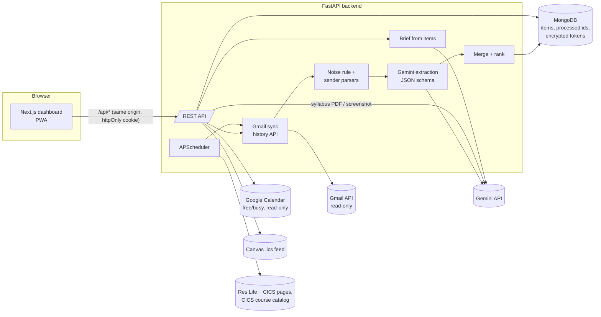

# UMass Radar

A dashboard for UMass Amherst students that pulls everything you need to act on out of your UMass inbox and Canvas: deadlines, appointments, replies you owe, opportunities and events. Open it any time of day and see what's next, instead of digging through Piazza digests, Gradescope receipts and newsletters.

Built for HackUMass XIV.

> Screenshots: _coming soon_

## What it does

- **Reads your UMass Gmail (read-only)** and turns each email into structured items: `deadline`, `appointment`, `reply_owed`, `status_update`, `opportunity`, `event`, `course_info` or `noise`.
- **Rule parsers first** for the senders every student gets: Piazza, Campuswire, Gradescope, Canvas, Handshake, EAB Navigate and Residential Life. They're fast, free and predictable.
- **Gemini for everything else** (a professor asking for your transcript, a club deadline, the Bursar), using structured JSON output. Every item keeps the exact sentence it came from as evidence.
- **Filters noise**: promotions and newsletters from non-academic senders are counted and hidden.
- **Merges duplicates** (the same assignment from a Canvas email and the Canvas calendar feed) and **ranks by urgency** (time left, type, whether you need to act, who sent it).
- **Canvas calendar feed** import for assignment due dates.
- **A short brief** at the top, written only from the extracted items (never raw email). It shows up instantly and is refreshed by Gemini in the background.
- **Home is a summary**: the brief, a **Today** timeline (classes, things due and office hours around a "now" marker), the next three things to do, and counts that link to the detail pages: **To do**, **Schedule**, **Opportunities**, **Updates** and **Courses**. Global search covers email items and courses.
- Syncs when you open it, when you hit Refresh, and in the background (6 AM, then every 30 minutes until midnight).
- **Imports**: upload a **syllabus PDF** (office hours, exam dates, due dates, grading and late policy) or a **screenshot** of SPIRE, the housing portal or Navigate (enrollment appointments, holds, time slots). Files are read once and thrown away.
- **Office hours you can make**: connect Google Calendar (read-only) and each office-hour slot from your syllabi says whether you're actually free, with a 10-minute walking buffer.
- **Campus page watchers**: Residential Life jobs and events and CICS events are checked twice a day. When a page changes, new RA/PM postings and events show up for everyone.
- **Class schedule**: upload a screenshot of your schedule from SPIRE or UMass College Scheduler (read with Gemini vision, then each class is snapped to its exact section in the course catalog, so times, sections and rooms come out right even when the picture is fuzzy), or SPIRE's calendar export (.ics, parsed exactly). It drives the Schedule week grid, the Today timeline, office-hours "you're free" checks and section clashes. UMass has no student-facing SPIRE API, so these two are the fastest ways in.
- **Course profiles for every UMass department** (about 6,000 courses, all sections and meeting times) from the public Five College course schedule, with richer CICS descriptions and prerequisites from the CICS catalog.
- **Syllabus library**: public syllabi from the last 12 months (collected from course sites) plus any PDFs you drop in `backend/seed/syllabi/`. Each course page shows office hours, grading, late policy and exam dates "from the Spring 2026 syllabus", with a link to the original. Students can add the syllabus for any course they take.
- **Course profiles and search**: every CICS course from the public catalog, with sections, times, rooms, prerequisites and instructors. Student-shared syllabus facts (office hours, grading, late policy, exam dates) are added on top. Your current courses are detected from your inbox. Add courses to a plan, pick sections, and see which ones clash with the rest of your plan.
- **Jobs**: open student jobs from UMass Dining, RecWell, Res Life, Residential Services, CMASS and HR pages, plus job emails (Handshake, Student Employment), with direct links to the official Student Employment board and Handshake.
- **Clubs and campus events**: every upcoming event from events.umass.edu. Follow an organization and its events land on your Home and Schedule. Clubs that only post on Instagram can be added by screenshotting a post or flyer: meetings become events and sign-ups become deadlines.
- **Accounts that remember you**: sign in with your UMass Google account once. You stay signed in for the semester on each device, later sign-ins skip the permission screen, and the Profile page shows everything saved (name, major, class year, schedule, followed clubs, connected accounts) with one-click delete.
- **Demo mode**: "Load demo inbox" runs 40 realistic fake UMass emails through the same pipeline, with no Google login needed.
- Installable as a PWA.

## Architecture



Pipeline for each new email: skip your own sent mail → sender parser (if one matches) → noise rule → Gemini for anything left → merge duplicates → urgency score → save items. Email bodies only live in memory while this runs.

```
backend/
  app/          FastAPI app: auth, sync, pipeline, merge, ranking, routes
  parsers/      one file per sender + shared date/course helpers
  llm/          Gemini extraction and the brief
  demo/         demo inbox (emails.json) and labels (labels.csv)
  eval/         accuracy evaluation
  app/catalog.py    CICS course catalog import (python -m app.catalog)
  app/watchers.py   Res Life / CICS page watchers
  tests/        pytest + sample emails in tests/fixtures
frontend/       Next.js (App Router) + TypeScript + Tailwind
```

## Running it locally

You need Python 3.11+, Node 20+ and Docker (for MongoDB).

```bash
# 1. database
docker compose up -d mongo

# 2. backend
cd backend
python3 -m venv .venv
.venv/bin/pip install -r requirements.txt
cp .env.example .env        # then fill it in, see below
.venv/bin/uvicorn app.main:app --reload --port 8000

# 3. frontend (new terminal)
cd frontend
npm install
npm run dev
```

Load course data once (and again each semester):

```bash
cd backend
.venv/bin/python -m app.catalog            # CICS descriptions + schedule (fast)
.venv/bin/python -m app.fivecolleges       # every UMass department, ~360 listing pages at 1/second (~6 min, resumable)
.venv/bin/python -m app.syllabus_library   # public syllabi in seed/syllabus_sources.csv + PDFs in seed/syllabi/
```

Open http://localhost:3000. Click **Load demo inbox** to try it without Google, or sign in with your UMass account.

### Google setup

UMass doesn't let student accounts create Google Cloud projects, so the project lives in a personal Gmail account:

1. Create a Cloud project and enable the **Gmail API**.
2. Google Auth Platform → Audience: **External**, publishing status **Testing**. Add each UMass address that should be able to sign in as a **test user**.
3. Data access: add `gmail.readonly`, `openid`, `userinfo.email` and (for the optional Calendar feature) `calendar.readonly`. Enable the **Google Calendar API** too. Calendar is requested separately, from Settings → Connect Google Calendar, so people who only want email aren't asked for it.
4. Clients → **Web application**, with redirect URI `http://localhost:8000/auth/callback` (plus your production URL later). Put the client ID and secret in `backend/.env`.

In Testing mode Google expires refresh tokens after about 7 days. The app notices (`invalid_grant`) and shows a **Reconnect Gmail** banner. If Google returns `access_denied` or `admin_policy_enforced`, you get a clear message and the rest of the app keeps working.

### Environment variables (`backend/.env`)

| Variable | What it is |
| --- | --- |
| `GOOGLE_CLIENT_ID`, `GOOGLE_CLIENT_SECRET` | Web OAuth client |
| `OAUTH_REDIRECT_URI` | `http://localhost:8000/auth/callback` locally; `https://<your-site>/api/auth/callback` in production |
| `FRONTEND_URL` | Where to send people after sign-in (`http://localhost:3000`) |
| `MONGODB_URI`, `MONGODB_DB` | Local Docker Mongo or MongoDB Atlas |
| `TOKEN_ENCRYPTION_KEY` | Fernet key for refresh tokens. Generate: `python -c "from cryptography.fernet import Fernet; print(Fernet.generate_key().decode())"` |
| `COOKIE_SECURE` | `true` when served over HTTPS |
| `GEMINI_API_KEY`, `GEMINI_MODEL` | Google AI Studio key; default model `gemini-3.8-flash` |
| `GEMINI_FALLBACK_MODEL` | Used for 5 minutes whenever the main model is overloaded (default `gemini-3.5-flash-lite`) |
| `ENABLE_SCHEDULER` | Background syncs on/off |

The frontend needs only `BACKEND_URL` (default `http://localhost:8000`). Every `/api/*` request is proxied there, so the browser only talks to one origin.

## Tests and evaluation

```bash
cd backend
.venv/bin/python -m pytest              # parsers, dates, merge, ranking, LLM (mocked), ics, brief
.venv/bin/python -m eval.evaluate       # rules only, on the 40 labeled demo emails
.venv/bin/python -m eval.evaluate --llm # rules + Gemini
```

The eval prints per-category precision, recall and F1, overall accuracy, date accuracy (same calendar day) and each miss. Labels live in `backend/demo/labels.csv` (`message_id,true_category,true_due`, where `true_due` is an ISO date or `+N` days from today, since the demo inbox is dated relative to today). Point `--labels` at your own CSV to evaluate a different set.

Results on the 40 demo emails:

| | accuracy | date accuracy (same day) | emails left unhandled |
| --- | --- | --- | --- |
| rules only | 57% | 50% | 16 |
| rules + Gemini | 90% | 88% | 0 |

Rules alone have precision 1.00 in every category except noise, but they only cover senders they know. Gemini picks up the human-written rest. The remaining misses are judgement calls (is a CICS newsletter noise or course info? is "fill out this form before our meeting" a deadline or a reply?), and the noise rule hides a recruiting email that's actually an opportunity.

## Design

The UI follows the UMass Amherst brand (umass.edu/brand): the 2026 digital maroon `#840028` with black `#212721` and the brand grays, and the approved web fonts, Open Sans for UI and Lora for headings. The one strong visual element is the Today timeline on Home; everything else stays quiet so students can scan it between classes.

## Data sources and etiquette

- **Five College course schedule** (fivecolleges.edu): robots.txt allows general crawlers with `search=yes, ai-train=no, use=reference`. We read listing pages at about one request per second, parse them without any model, and link back. Course descriptions are fetched one at a time, only when someone opens that course.
- **CICS catalog** and **Res Life / CICS pages**: public pages allowed by robots.txt.
- **Syllabi**: only public syllabi (or ones you provide) from the last 12 months. We keep extracted facts and a link, never the document.
- **Campus events** (events.umass.edu): the public Localist API, with the 1-second crawl delay its robots.txt asks for.
- **Student jobs**: department job pages that allow crawlers, read only when they change.
- **Sources we deliberately don't read**: the central Student Employment board (yes.umass.edu) and Campus Pulse's API both disallow bots in robots.txt, and Instagram's terms don't allow apps to read other accounts. The app links to the job board, and takes screenshots for Instagram posts instead.

## Privacy design

- **Read-only Gmail scope.** The app can't send, delete or modify mail.
- **No email bodies are stored.** Bodies exist only in memory during processing. MongoDB holds the extracted items (title, dates, one evidence sentence), the ids of processed messages, the Gmail history pointer and the LLM's structured output.
- **Tokens never reach the browser.** Refresh tokens and the Canvas feed URL are encrypted with Fernet. The browser holds only a random session id in a `Secure`, `httpOnly`, `SameSite=Lax` cookie, and sessions are stored hashed.
- **Minimal data to the model.** Gemini gets a cleaned subject plus the first 2000 characters of the plain-text body, with quoted reply history and URLs stripped. Each email is processed once (cached by message id). The brief is generated from item fields only.
- **Prompt-injection guard.** Email text is wrapped as untrusted data, and the model is told never to follow instructions inside it. Evidence that doesn't actually appear in the email drops the item's confidence.
- **Syllabi and screenshots aren't kept.** They're read once. A syllabus adds course facts (office hours, grading, late policy, exam dates) to that course's shared profile, with no record of who uploaded it.
- **Calendar is optional and read-only.** Only free/busy times are read, to check office hours. Events aren't stored.
- **Page watchers are polite.** They only read public pages allowed by robots.txt, twice a day, and only send a page to Gemini when it changed.
- **One-click delete.** Settings → *Delete all my data* removes the user, tokens, sessions, items, processed ids and cached model output.

## Sharing a live demo with ngrok

The quickest way to put a running laptop copy online for judges:

```bash
cd frontend && npm run build && npm start      # production server on :3000 (dev mode doesn't work well behind a tunnel)
ngrok http 3000                                # uses your account's free static *.ngrok-free.dev domain
```

Then in `backend/.env` set `OAUTH_REDIRECT_URI=https://<your-domain>/api/auth/callback`, `FRONTEND_URL=https://<your-domain>` and `COOKIE_SECURE=true`, restart the backend, and add that redirect URI to the Web OAuth client in Google Cloud. Everything goes through the frontend's `/api` proxy, so only port 3000 is exposed. Visitors see ngrok's one-time warning page first, and only test users can sign in with Google. Anyone can use **Load demo inbox**.

## Deploying

**Backend on a VM (e.g. Vultr):** `docker build -t umass-radar-backend backend` and run it with your `.env`, or use `docker compose -f docker-compose.prod.yml up -d --build` to run backend and frontend together. Put Caddy or nginx with HTTPS in front, use MongoDB Atlas for `MONGODB_URI`, and set `COOKIE_SECURE=true`.

**Frontend on Vercel:** import the `frontend` folder and set `BACKEND_URL` to the backend's public URL (it's read at build time). Set `OAUTH_REDIRECT_URI=https://<your-vercel-domain>/api/auth/callback` and `FRONTEND_URL=https://<your-vercel-domain>` on the backend, and add the same redirect URI to the Google OAuth client.

## Roadmap

- Club leaders connect their own Instagram business account (Meta Graph API, needs Meta app review) so posts flow in automatically
- Ask the Student Employment Office for a feed of the job board
- Course catalogs beyond CICS (UMass has no single public catalog page to read from yet)
- Use Calendar class times to flag plan conflicts with this semester's schedule
- Push notifications for deadlines in the next few hours
