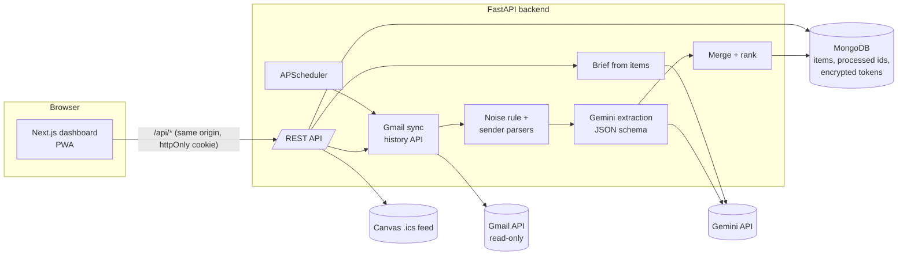

# UMass Radar

A dashboard for UMass Amherst students that pulls everything you need to act on out of your UMass inbox and Canvas: deadlines, appointments, replies you owe, opportunities and events. Open it any time of day and see what's next, instead of digging through Piazza digests, Gradescope receipts and newsletters.

Built for HackUMass XIV.

> Screenshots: _coming soon_

## What it does

- **Reads your UMass Gmail (read-only)** and turns each email into structured items: `deadline`, `appointment`, `reply_owed`, `status_update`, `opportunity`, `event`, `course_info` or `noise`.
- **Rule parsers first** for the senders every student gets: Piazza, Campuswire, Gradescope, Canvas, Handshake, EAB Navigate and Residential Life. They're fast, free and predictable.
- **Gemini for everything else** (a professor asking for your transcript, a club deadline, the Bursar), using structured JSON output. Every item keeps the exact sentence it came from as evidence.
- **Filters noise**: promotions and newsletters from non-academic senders are counted and hidden.
- **Merges duplicates** (the same assignment from a Canvas email and the Canvas calendar feed) and **ranks by urgency** (time left, type, whether you need to act, who sent it).
- **Canvas calendar feed** import for assignment due dates.
- **A short brief** at the top, written only from the extracted items (never raw email), with links to each item.
- Sections for **Coming up next**, **Today**, **This week**, **Opportunities**, **Waiting on**, **Course updates** and **Later**, plus search and filters.
- Syncs when you open it, when you hit Refresh, and in the background (6 AM, then every 30 minutes until midnight).
- **Demo mode**: "Load demo inbox" runs 40 realistic fake UMass emails through the same pipeline, with no Google login needed.
- Installable as a PWA.

## Architecture



Pipeline for each new email: skip your own sent mail → sender parser (if one matches) → noise rule → Gemini for anything left → merge duplicates → urgency score → save items. Email bodies only live in memory while this runs.

```
backend/
  app/          FastAPI app: auth, sync, pipeline, merge, ranking, routes
  parsers/      one file per sender + shared date/course helpers
  llm/          Gemini extraction and the brief
  demo/         demo inbox (emails.json) and labels (labels.csv)
  eval/         accuracy evaluation
  tests/        pytest + sample emails in tests/fixtures
frontend/       Next.js (App Router) + TypeScript + Tailwind
```

## Running it locally

You need Python 3.11+, Node 20+ and Docker (for MongoDB).

```bash
# 1. database
docker compose up -d mongo

# 2. backend
cd backend
python3 -m venv .venv
.venv/bin/pip install -r requirements.txt
cp .env.example .env        # then fill it in, see below
.venv/bin/uvicorn app.main:app --reload --port 8000

# 3. frontend (new terminal)
cd frontend
npm install
npm run dev
```

Open http://localhost:3000. Click **Load demo inbox** to try it without Google, or sign in with your UMass account.

### Google setup

UMass doesn't let student accounts create Google Cloud projects, so the project lives in a personal Gmail account:

1. Create a Cloud project and enable the **Gmail API**.
2. Google Auth Platform → Audience: **External**, publishing status **Testing**. Add each UMass address that should be able to sign in as a **test user**.
3. Data access: add `gmail.readonly`, `openid`, `userinfo.email`.
4. Clients → **Web application**, with redirect URI `http://localhost:8000/auth/callback` (plus your production URL later). Put the client ID and secret in `backend/.env`.

In Testing mode Google expires refresh tokens after about 7 days. The app notices (`invalid_grant`) and shows a **Reconnect Gmail** banner. If Google returns `access_denied` or `admin_policy_enforced`, you get a clear message and the rest of the app keeps working.

### Environment variables (`backend/.env`)

| Variable | What it is |
| --- | --- |
| `GOOGLE_CLIENT_ID`, `GOOGLE_CLIENT_SECRET` | Web OAuth client |
| `OAUTH_REDIRECT_URI` | `http://localhost:8000/auth/callback` locally; `https://<your-site>/api/auth/callback` in production |
| `FRONTEND_URL` | Where to send people after sign-in (`http://localhost:3000`) |
| `MONGODB_URI`, `MONGODB_DB` | Local Docker Mongo or MongoDB Atlas |
| `TOKEN_ENCRYPTION_KEY` | Fernet key for refresh tokens. Generate: `python -c "from cryptography.fernet import Fernet; print(Fernet.generate_key().decode())"` |
| `COOKIE_SECURE` | `true` when served over HTTPS |
| `GEMINI_API_KEY`, `GEMINI_MODEL` | Google AI Studio key; default model `gemini-3.8-flash` |
| `ENABLE_SCHEDULER` | Background syncs on/off |

The frontend needs only `BACKEND_URL` (default `http://localhost:8000`). Every `/api/*` request is proxied there, so the browser only talks to one origin.

## Tests and evaluation

```bash
cd backend
.venv/bin/python -m pytest              # parsers, dates, merge, ranking, LLM (mocked), ics, brief
.venv/bin/python -m eval.evaluate       # rules only, on the 40 labeled demo emails
.venv/bin/python -m eval.evaluate --llm # rules + Gemini
```

The eval prints per-category precision, recall and F1, overall accuracy, date accuracy (same calendar day) and each miss. Labels live in `backend/demo/labels.csv` (`message_id,true_category,true_due`, where `true_due` is an ISO date or `+N` days from today, since the demo inbox is dated relative to today). Point `--labels` at your own CSV to evaluate a different set.

Results on the 40 demo emails:

| | accuracy | date accuracy (same day) | emails left unhandled |
| --- | --- | --- | --- |
| rules only | 57% | 50% | 16 |
| rules + Gemini | 90% | 88% | 0 |

Rules alone have precision 1.00 in every category except noise, but they only cover senders they know. Gemini picks up the human-written rest. The remaining misses are judgement calls (is a CICS newsletter noise or course info? is "fill out this form before our meeting" a deadline or a reply?), and the noise rule hides a recruiting email that's actually an opportunity.

## Privacy design

- **Read-only Gmail scope.** The app can't send, delete or modify mail.
- **No email bodies are stored.** Bodies exist only in memory during processing. MongoDB holds the extracted items (title, dates, one evidence sentence), the ids of processed messages, the Gmail history pointer and the LLM's structured output.
- **Tokens never reach the browser.** Refresh tokens and the Canvas feed URL are encrypted with Fernet. The browser holds only a random session id in a `Secure`, `httpOnly`, `SameSite=Lax` cookie, and sessions are stored hashed.
- **Minimal data to the model.** Gemini gets a cleaned subject plus the first 2000 characters of the plain-text body, with quoted reply history and URLs stripped. Each email is processed once (cached by message id). The brief is generated from item fields only.
- **Prompt-injection guard.** Email text is wrapped as untrusted data, and the model is told never to follow instructions inside it. Evidence that doesn't actually appear in the email drops the item's confidence.
- **One-click delete.** Settings → *Delete all my data* removes the user, tokens, sessions, items, processed ids and cached model output.

## Deploying

**Backend on a VM (e.g. Vultr):** `docker build -t umass-radar-backend backend` and run it with your `.env`, or use `docker compose -f docker-compose.prod.yml up -d --build` to run backend and frontend together. Put Caddy or nginx with HTTPS in front, use MongoDB Atlas for `MONGODB_URI`, and set `COOKIE_SECURE=true`.

**Frontend on Vercel:** import the `frontend` folder and set `BACKEND_URL` to the backend's public URL (it's read at build time). Set `OAUTH_REDIRECT_URI=https://<your-vercel-domain>/api/auth/callback` and `FRONTEND_URL=https://<your-vercel-domain>` on the backend, and add the same redirect URI to the Google OAuth client.

## Roadmap

- Syllabus PDF upload (office hours, exam dates)
- Google Calendar (read-only): "office hours you can make this week"
- Screenshot import (SPIRE, housing portal) with Gemini vision
- Watchers for Res Life and CICS pages (RA/PM postings, events)
