<p align="center">
  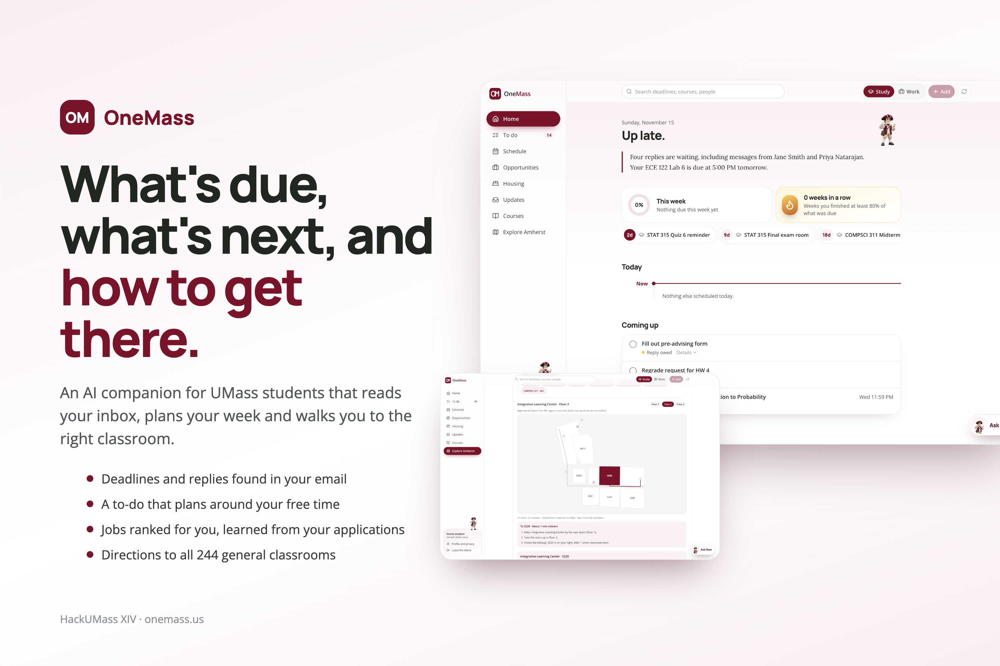
</p>

<h1 align="center">OneMass</h1>

<p align="center">
  <b>What's due, what's next, and how to get there.</b><br>
  A campus companion for UMass Amherst students: it reads your inbox, plans your week in study or work mode,<br>
  ranks jobs for you, and walks you to the right classroom.
</p>

<p align="center">
  <a href="https://www.onemass.us"><b>Live site: onemass.us</b></a> ·
  Built at <b>HackUMass XIV</b> ·
  <a href="docs/HANDOFF.md">Team handoff</a> ·
  <a href="docs/API.md">API guide</a>
</p>

---

## Contents

1. [Why OneMass](#why-onemass)
2. [Tour](#tour)
3. [Features](#features)
4. [How it works](#how-it-works)
5. [Finding any classroom](#finding-any-classroom)
6. [The to-do agent](#the-to-do-agent)
7. [Mobile app](#mobile-app)
8. [Repository layout](#repository-layout)
9. [Running it locally](#running-it-locally)
10. [Google sign-in setup](#google-sign-in-setup)
11. [Hosting](#hosting)
12. [Tests and evaluation](#tests-and-evaluation)
13. [Data sources and etiquette](#data-sources-and-etiquette)
14. [Privacy design](#privacy-design)
15. [Roadmap](#roadmap)

---

## Why OneMass

A UMass student gets dozens of emails a day: Canvas, Gradescope, Piazza, professors, Handshake, Res Life, clubs.
The one deadline that matters is buried in there. And every semester, freshmen get lost the same way: Google Maps gets
you to Morrill, but not to room **N375**.

OneMass reads the noise for you, tells you what to do next, and gets you to the right room.

---

## Tour

| | |
|:---:|:---:|
| 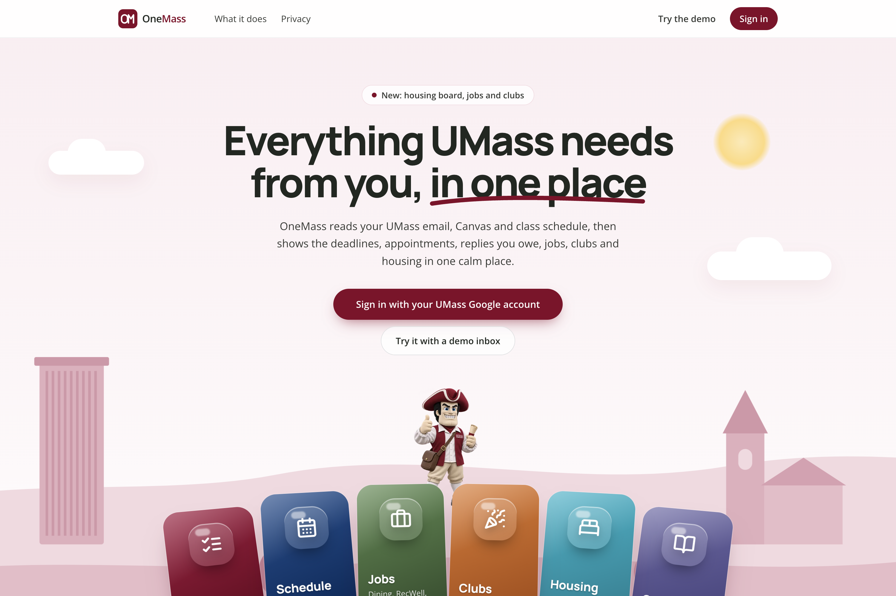<br>**Landing.** Sam the minuteman and a 3D card fan | 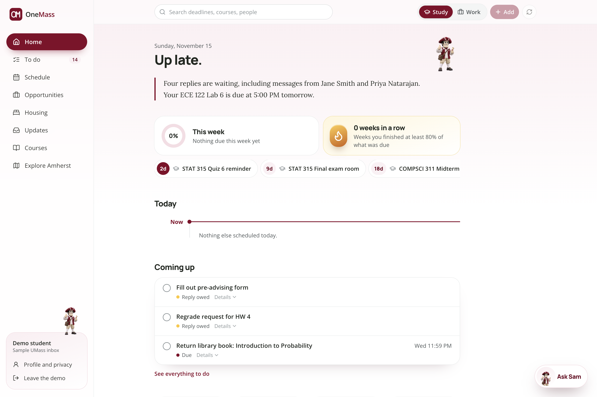<br>**Home.** Brief, your week, exam countdowns |
| 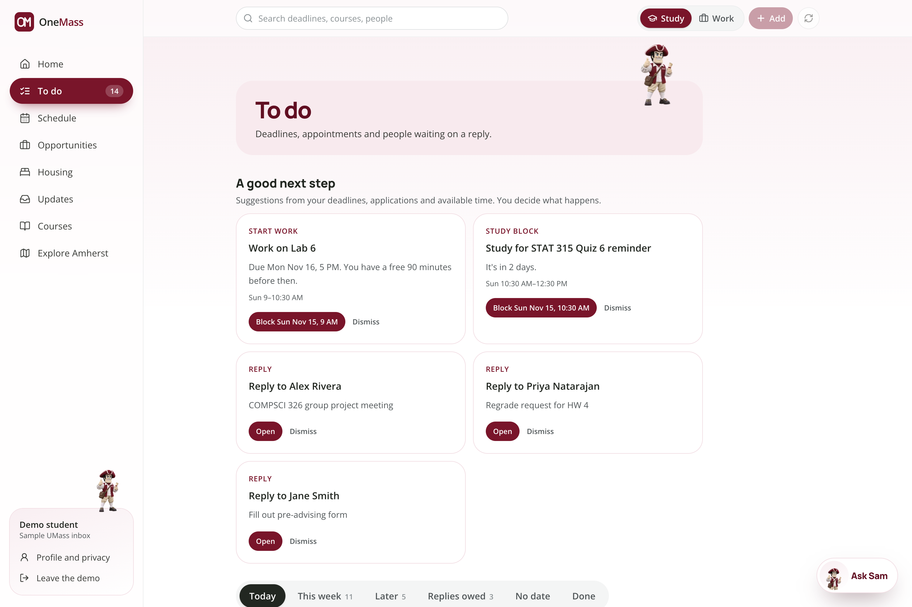<br>**To do.** Suggested next steps that fit your free time | 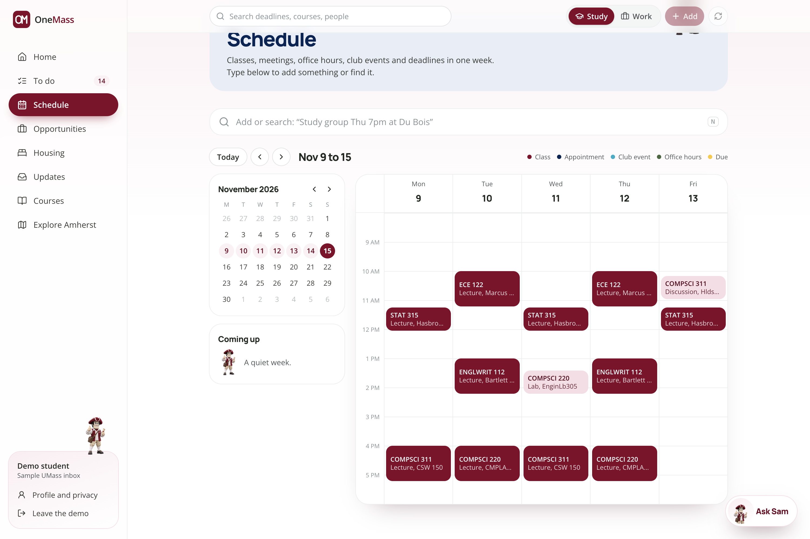<br>**Schedule.** Classes, meetings and deadlines in one week |
| 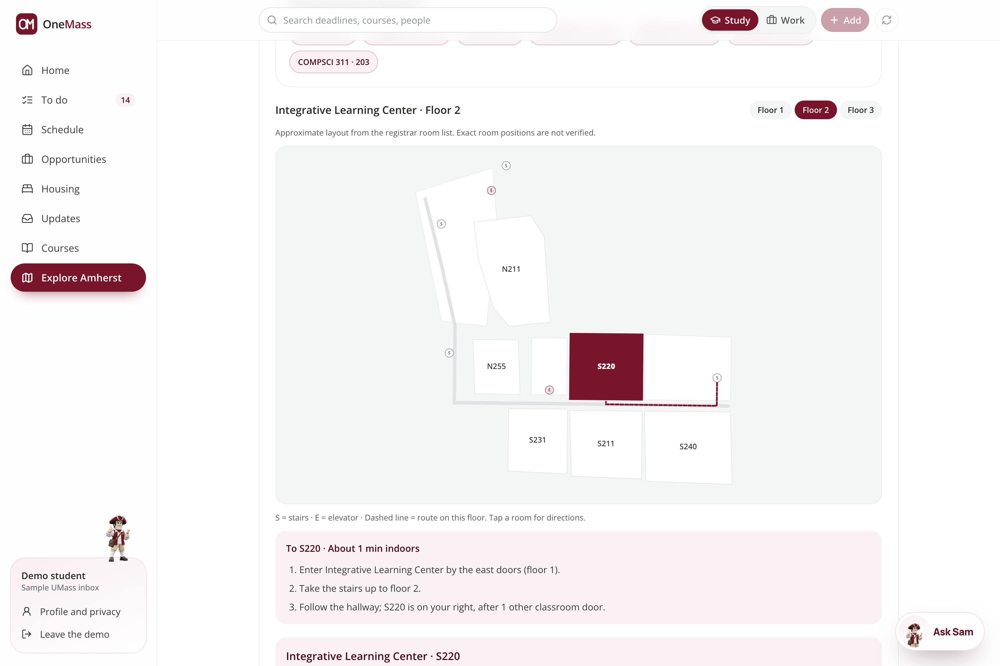<br>**Find any classroom.** Floor plan, route and steps | 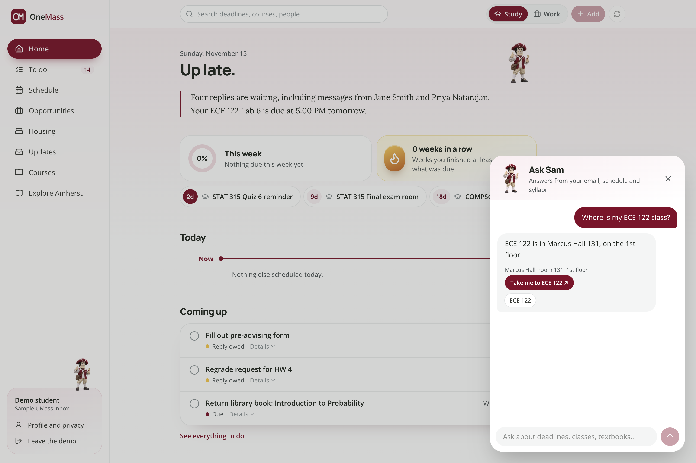<br>**Ask Sam.** "Where is my ECE 122 class?" |
| 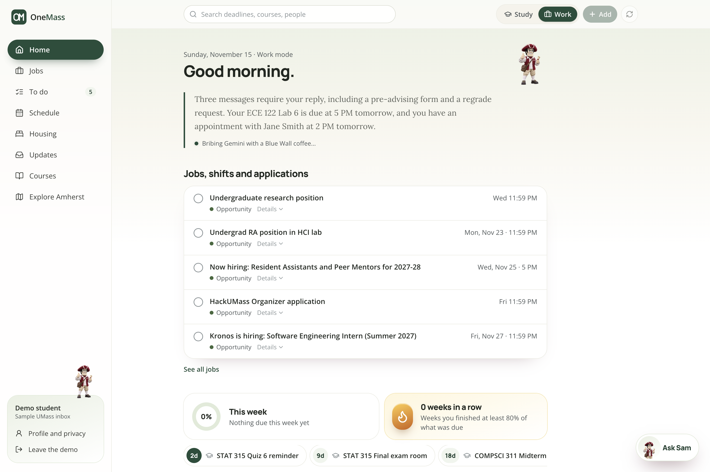<br>**Work mode.** Jobs, applications and housing come first | 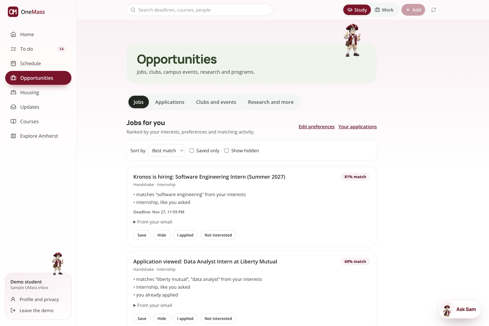<br>**Jobs for you.** Match scores with plain reasons |
| 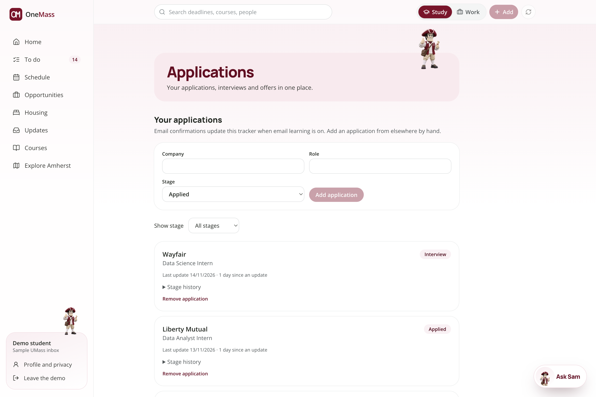<br>**Applications.** Tracked from your email | 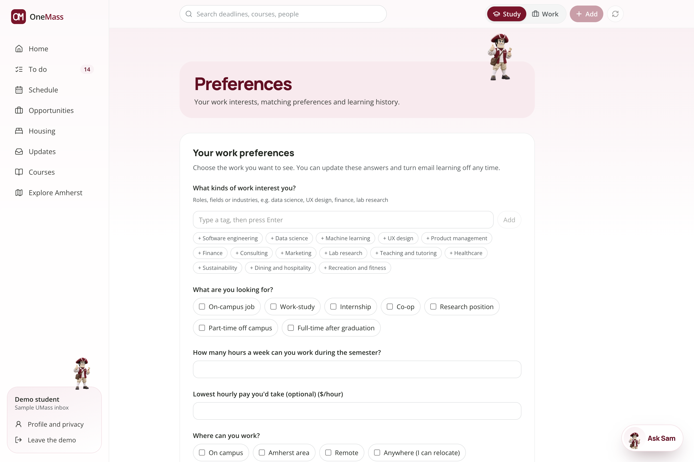<br>**Preferences.** What you want, and what it learned |
| 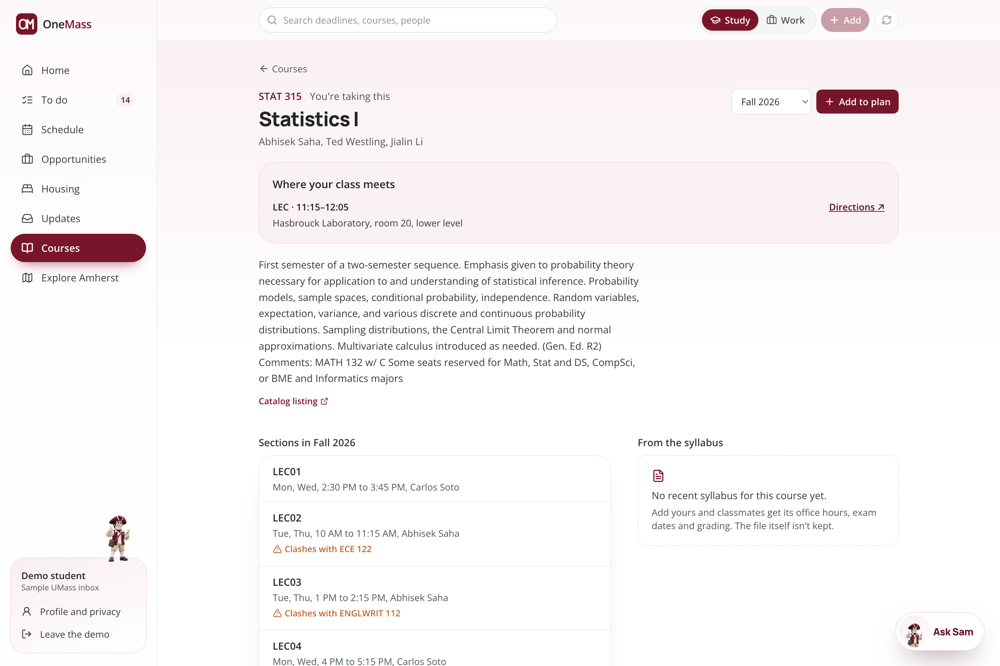<br>**Course pages.** Where your section meets, sections, clashes | 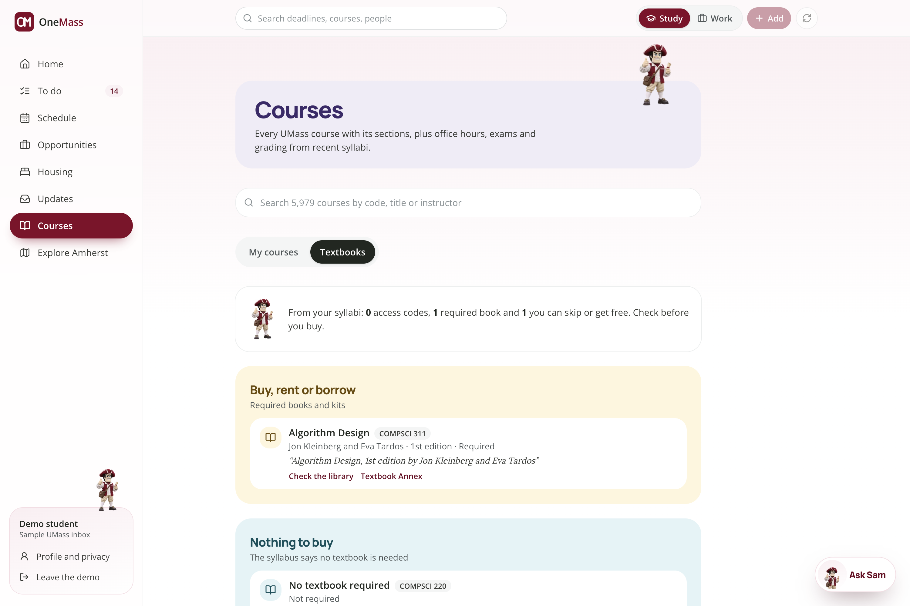<br>**Textbooks.** Pulled from syllabi: buy, skip or borrow |
| 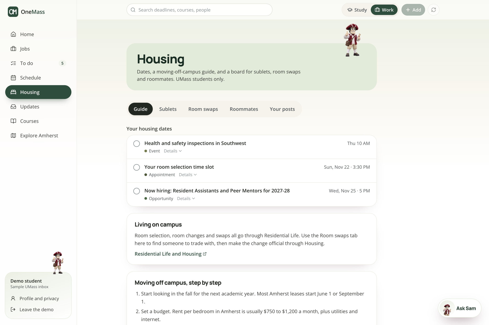<br>**Housing.** Your housing dates, a guide, sublets and swaps | 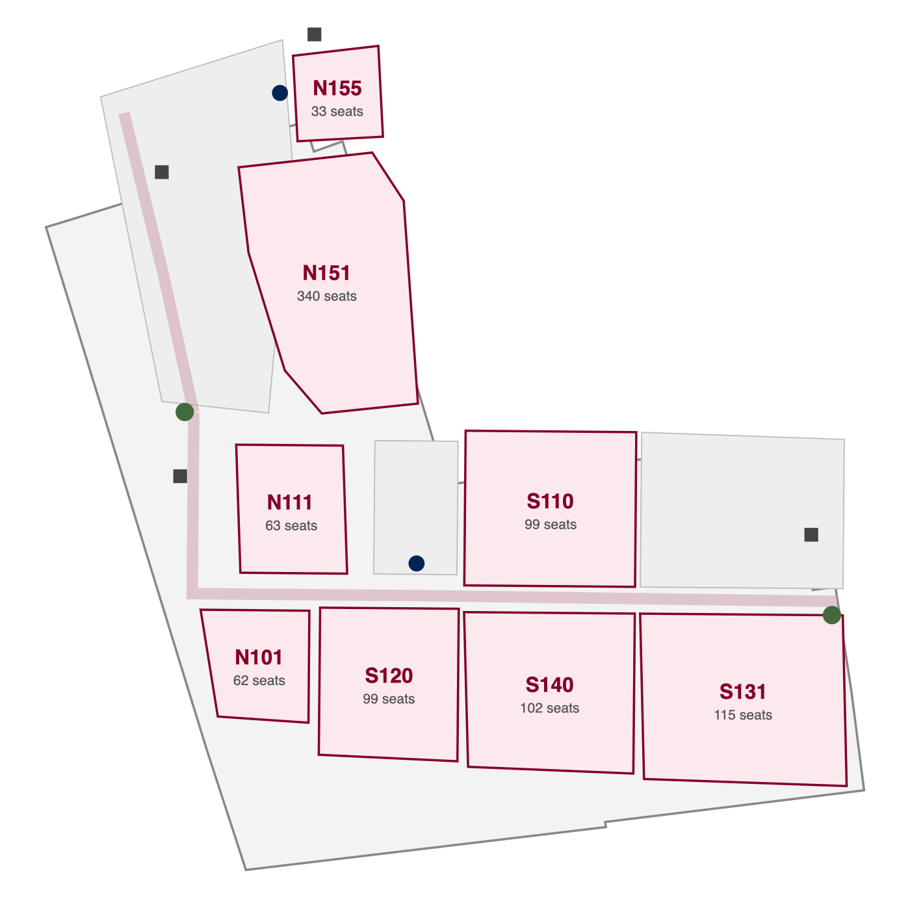<br>**ILC floor 1.** Traced from the posted floor plan |

---

## Features

### Your inbox, turned into a plan
- **Reads your UMass Gmail (read-only)** and turns each email into an item: deadline, appointment, reply you owe,
  status update, opportunity, event, course info, or noise. Each item keeps the sentence it came from as evidence.
- **Rule parsers first** for the senders every student gets (Piazza, Campuswire, Gradescope, Canvas, Handshake,
  EAB Navigate, Residential Life). Gemini reads only what's left.
- **Noise is filtered**, **duplicates are merged**, and everything is **ranked by urgency**.
- **A short brief** at the top of Home, written from your items, never from raw email.
- **Canvas calendar feed** import, and **imports** for syllabus PDFs and screenshots (SPIRE, the housing portal,
  Navigate, club flyers).

### Study mode and Work mode
- A switch in the top bar. **Study** shows classes, coursework and the schedule. **Work** shows jobs, internships,
  applications and housing, in its own forest-green look.
- Everything follows the mode: the brief, the to-do list, the menu order and Ask Sam.

### A to-do list that plans for you
- Suggested next steps, each with a reason: a free 90 minutes to start Lab 6 before it's due, office hours you can
  actually make, a study block before a quiz, prep time before an interview, or a follow-up note when an application
  has been quiet for 10+ days.
- **Accept** one and it lands on your calendar. **Dismiss** it and it stays gone. Suggested blocks never overlap.
- See [The to-do agent](#the-to-do-agent).

### Jobs ranked for you
- **Ask first:** a few questions when you sign in (interests, job types, hours, pay, where you can work, work-study).
- **Then learn:** application confirmations, interviews, offers and rejections in your inbox (Workday, Greenhouse,
  Handshake and others) build an **applications tracker**, and what you save or hide tunes your matches.
- Every job gets a **0–100 match** and plain reasons ("matches *software engineering*", "internship, like you asked").
- A **"what we learned" log** shows every signal and where it came from, and you can remove any of them.

### Schedule you can type into
- Type "Coffee with Priya tue 3pm at Roots for 30 min" and it's added. Type a name and it searches instead.
- One week view of classes, labs, meetings, office hours, club events, Google Calendar events and deadlines.
- Duplicates from email and Google Calendar are merged. Date-only items go in the all-day row. Busy hours show the
  two most important events side by side, with a "+N" button for the rest.
- Classes come from a **SPIRE or College Scheduler screenshot** (read with Gemini vision, then snapped to the real
  catalog sections) or SPIRE's **.ics export**.

### Find any classroom
- Search **ILC S220** or tap one of your classes: the building, the door to use, the floor plan, the floor, and
  turn-by-turn steps, with a **step-free route** that uses elevators only.
- Covers **all 244 general-purpose classrooms** on the registrar's list, in 44 buildings.
- **Where are my classes?** Every class with building, room, floor and walking time from the class before.
- See [Finding any classroom](#finding-any-classroom).

### Ask Sam
- Ask anything about your own week: "What's due this week?", "Who am I waiting to reply to?", "Do I need to buy the
  textbook?", "Where is my ECE 122 class?". Answers link to the items they used.
- When you ask where a class is, Sam adds a **Take me there** button that opens the map with directions.

### Courses, textbooks and syllabi
- **About 6,000 UMass courses** from the Five College course schedule, with sections, times and rooms, plus richer CICS
  descriptions and prerequisites.
- **Syllabus library**: public syllabi from the last 12 months. Each course page shows office hours, grading, late
  policy, exam dates and **textbooks**, "from the Fall 2026 syllabus", with a link to the original.
- **Textbooks tab**: everything your syllabi say, grouped into *access code needed*, *buy, rent or borrow*,
  *optional* and *nothing to buy*, with links to the library and the Textbook Annex.
- Plan next semester's courses and see section clashes.

### Campus life
- **Housing**: your housing dates from email, a guide to moving off campus, and a UMass-only board for sublets, room
  swaps and roommates. Emails stay private until both people agree.
- **Clubs and events**: every event from events.umass.edu. Follow a club and its events land on your schedule.
- **Explore Amherst**: a campus map with classes, food, study spots and trails.
- **Progress**: weekly completion, a streak of good weeks, and exam countdowns.

### Accounts
- Sign in with your UMass Google account and stay signed in all semester.
- A **demo account** with a realistic fake inbox, so anyone can try it without Google.
- One-click delete of everything.

---

## How it works

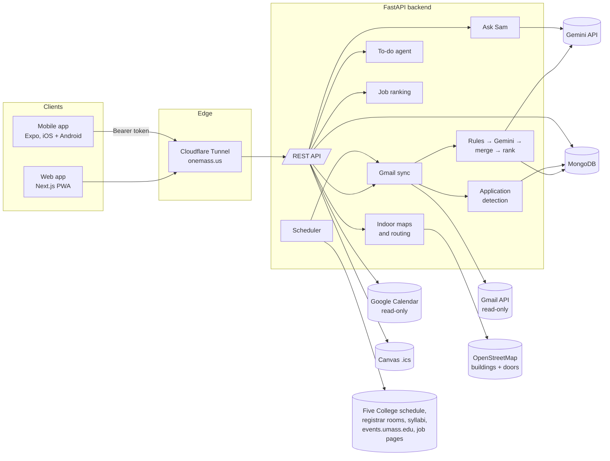

**What happens to each new email:**

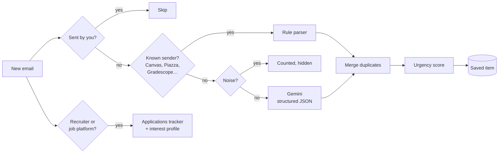

Email bodies live only in memory while this runs. Only the extracted items are saved.

**Stack:**
- **Backend:** FastAPI, MongoDB (Motor), APScheduler, Google APIs (Gmail, Calendar, OAuth), Gemini
  (`google-genai`; Flash for extraction, Flash-Lite for the brief and Ask Sam, with fallbacks and timeouts)
- **Web:** Next.js (App Router), React, TypeScript, Tailwind, Leaflet
- **Mobile:** Expo (React Native), react-native-maps
- **Hosting:** Cloudflare Tunnel on onemass.us

---

## Finding any classroom

UMass doesn't publish classroom floor plans, so OneMass builds indoor maps from public data:

| Source | What it gives |
|---|---|
| University Registrar's classroom list | Every general-purpose classroom: 244 rooms in 44 buildings, with seats and features |
| OpenStreetMap | Building outlines (Morrill I–IV, Lederle and so on) and entrances, some with floor levels |
| Posted floor plan in the ILC | ILC floor 1, traced room by room |
| SPIRE and catalog room codes | `MOR1N375`, `LGRT0143`, `ILCS120`, `Mach W-26`: all mapped to buildings |

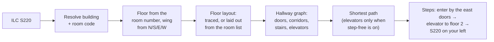

<p align="center"></p>

- ILC floor 1 is traced from its posted floor plan.
- Other floors are laid out from the official room list (right floor and side, rooms in number order) and labeled
  *approximate layout* in the app.
- Students can confirm where a room really is: two matching confirmations replace the estimate.
- A request to UMass Planning, Design & Construction for real floor plans is drafted in
  [`docs/floorplan-request.md`](docs/floorplan-request.md).

---

## The to-do agent

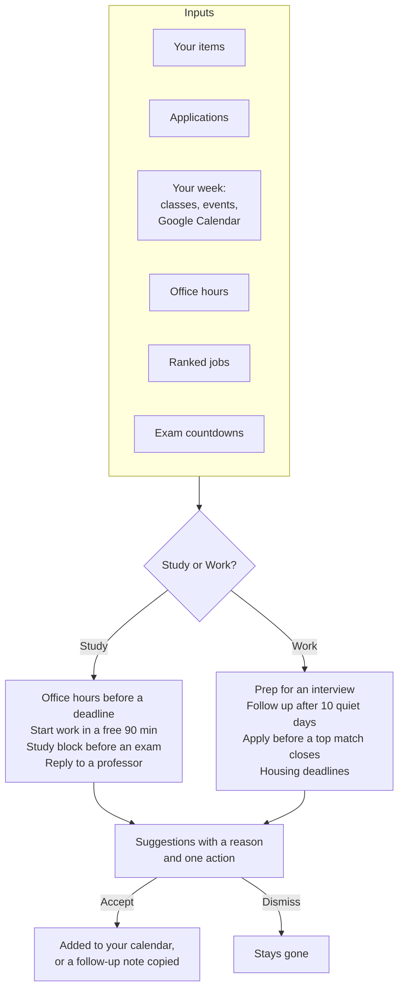

Suggestions are built by rules over your own data, so they're fast and predictable. Free time comes from your real
week, with nights excluded, and two suggested blocks never take the same time.

---

## Mobile app

`mobile/` is an Expo app: one codebase for **iOS and Android**, using the same backend.

- **Home:** greeting with Sam, the brief, your next class with a **Navigate** button, progress, and where all your
  classes are
- **To do:** the Study/Work switch, suggestions you can accept or dismiss, and tasks to check off
- **Map:** a calm campus map, your class buildings highlighted, room search, indoor floors, route line, numbered
  steps, and a step-free switch

```bash
cd mobile
npm install
echo "EXPO_PUBLIC_API_URL=https://www.onemass.us/api" > .env
npx expo start            # scan the QR code with Expo Go (iOS or Android)
```

Tap **Try the demo** to sign in without a Google account. The full test checklist is in
[`docs/HANDOFF.md`](docs/HANDOFF.md#5-mobile-app-mobile).

---

## Repository layout

```
backend/
  app/            FastAPI app: auth, sync, pipeline, modes, jobs, applications, agent,
                  buildings, indoor maps and routing, week view, progress
  app/routes/     REST endpoints (items, todo, jobs, preferences, applications, schedule,
                  events, indoor, rooms, courses, housing, ask, …)
  parsers/        one file per sender, plus shared date and course helpers
  llm/            Gemini: extraction, brief, syllabi, screenshots, Ask Sam
  seed/           registrar classrooms, OpenStreetMap buildings, ILC floor trace, syllabus sources
  demo/           demo inbox (emails.json), labels, schedule
  eval/           accuracy evaluation
  tests/          pytest (182 tests)
frontend/         Next.js web app
mobile/           Expo app for iOS and Android
docs/             API guide, handoff, Devpost write-up, images
```

---

## Running it locally

You need Python 3.11+, Node 20+ and Docker (for MongoDB).

```bash
# 1. database
docker compose up -d mongo

# 2. backend (http://localhost:8000)
cd backend
python3 -m venv .venv
.venv/bin/pip install -r requirements.txt
cp .env.example .env        # fill it in, see below
.venv/bin/uvicorn app.main:app --reload --port 8000

# 3. web app (http://localhost:3000), new terminal
cd frontend
npm install
npm run dev
```

Load course and campus data once (and again each semester):

```bash
cd backend
.venv/bin/python -m app.catalog            # CICS descriptions and schedule
.venv/bin/python -m app.fivecolleges       # every UMass department (~6 min, resumable)
.venv/bin/python -m app.syllabus_library   # public syllabi in seed/syllabus_sources.csv + PDFs in seed/syllabi/
.venv/bin/python -m app.registrar_rooms    # the registrar's classroom list (already in seed/)
.venv/bin/python -m app.buildings_osm      # OpenStreetMap buildings and doors (already in seed/)
```

Open http://localhost:3000 and click **Try it with a demo inbox**, or sign in with your UMass account.

### Environment variables (`backend/.env`)

| Variable | What it is |
| --- | --- |
| `GOOGLE_CLIENT_ID`, `GOOGLE_CLIENT_SECRET` | Web OAuth client |
| `OAUTH_REDIRECT_URI` | `http://localhost:8000/auth/callback` locally; `https://www.onemass.us/api/auth/callback` live |
| `FRONTEND_URL` | Where to send people after sign-in |
| `MONGODB_URI`, `MONGODB_DB` | Local Docker Mongo or MongoDB Atlas |
| `TOKEN_ENCRYPTION_KEY` | Fernet key for Google tokens: `python -c "from cryptography.fernet import Fernet; print(Fernet.generate_key().decode())"` |
| `COOKIE_SECURE` | `true` when served over HTTPS |
| `GEMINI_API_KEY`, `GEMINI_MODEL` | Google AI Studio key; default model `gemini-3.8-flash` |
| `GEMINI_FALLBACK_MODEL`, `GEMINI_BRIEF_MODEL` | Fast model for fallbacks, the brief and Ask Sam (default `gemini-3.5-flash-lite`) |
| `ENABLE_SCHEDULER` | Background syncs on or off |

The web app needs only `BACKEND_URL` (default `http://localhost:8000`). Every `/api/*` request is forwarded there,
so the browser talks to one origin. The mobile app needs `EXPO_PUBLIC_API_URL`.

---

## Google sign-in setup

UMass doesn't let student accounts create Google Cloud projects, so the project lives in a personal Gmail account.

1. Create a Cloud project and enable the **Gmail API** and **Google Calendar API**.
2. **Google Auth Platform → Audience:** External. In **Testing**, add each @umass.edu address that should sign in as a
   **test user** (up to 100).
3. **Data access:** `gmail.readonly`, `openid`, `userinfo.email`, and `calendar.readonly` (asked for separately, only
   when someone connects Calendar).
4. **Clients → Web application.** Add the redirect URIs (`http://localhost:8000/auth/callback` and
   `https://www.onemass.us/api/auth/callback`) and the JavaScript origin `https://www.onemass.us`.

**Letting everyone sign in:**
- Publishing the app lets any Google account in, but Gmail access is a restricted permission.
- Until Google verifies the app, people see an "unverified app" screen and it's capped at 100 users.
- Verification needs a privacy policy on onemass.us, a verified domain and a security assessment.
- In Testing mode, Gmail access expires about every 7 days; the app shows a **Reconnect Gmail** banner when it does.

---

## Hosting

**onemass.us (current):** the web app runs on a machine behind a **Cloudflare Tunnel**. No ports are opened, and
HTTPS is automatic.

```bash
cloudflared tunnel login                         # once, pick onemass.us
cloudflared tunnel create onemass
cloudflared tunnel route dns onemass www.onemass.us
cloudflared tunnel run onemass                   # ~/.cloudflared/config.yml sends traffic to localhost:3000
```

**ngrok (quick sharing):** `ngrok http 3000` on the account's free static domain. Point `OAUTH_REDIRECT_URI` and
`FRONTEND_URL` at it.

**Full deploy:** `docker compose -f docker-compose.prod.yml up -d --build` on a VM (for example Vultr) with MongoDB
Atlas, or the web app on Vercel with `BACKEND_URL` set to the backend.

---

## Tests and evaluation

```bash
cd backend
.venv/bin/python -m pytest              # 182 tests
.venv/bin/python -m eval.evaluate       # rules only, on the 40 labeled demo emails
.venv/bin/python -m eval.evaluate --llm # rules + Gemini
```

The tests cover parsers, dates, merging, ranking, mode classification, preferences, application detection, job
ranking, the to-do agent, the week view, room codes, indoor routing (every classroom reachable, step-free routes never
use stairs), mobile sign-in and more.

Extraction accuracy on the 40 demo emails:

| | accuracy | date accuracy (same day) | emails left unhandled |
| --- | --- | --- | --- |
| rules only | 57% | 50% | 16 |
| rules + Gemini | 90% | 88% | 0 |

Rules alone are precise but only cover senders they know; Gemini handles the human-written rest.

---

## Data sources and etiquette

- **Five College course schedule:** read at about one request per second, as robots.txt allows, parsed without any
  model, with links back.
- **University Registrar classroom list** and **OpenStreetMap** (© OpenStreetMap contributors, ODbL): imported once,
  then served from `seed/`.
- **Syllabi:** only public syllabi (or ones students provide) from the last 12 months. We keep the extracted facts and a
  link, never the document.
- **events.umass.edu:** the public events API, with the crawl delay its robots.txt asks for.
- **Department job pages:** read only when they change.
- **Sources we deliberately don't read:**
  - the central Student Employment board and Campus Pulse's API, which disallow bots
  - Instagram, whose terms don't allow it
  - Students can screenshot a club post instead, and the job board can be sent with a bookmark button.

---

## Privacy design

- **Read-only Gmail.** OneMass can't send, delete or change mail.
- **No email bodies are stored.** Only extracted items (title, dates, one evidence sentence) and processed message ids.
- **Applications keep only company, role and stage**, never the email. Students can turn email learning off.
- **Tokens never reach the browser.**
  - Google tokens and the Canvas feed URL are encrypted.
  - The browser holds only a random session id in a secure, httpOnly cookie, and sessions are stored hashed.
  - The mobile app keeps its token in the phone's secure storage.
- **Minimal data to the model.** Cleaned subject and the start of the plain-text body, wrapped as untrusted data, and
  each email processed once.
- **You can see and undo what it learned**, and delete everything with one click.
- **Calendar is optional and read-only.** Events are read live, not stored.

---

## Roadmap

- Real floor plans from UMass Facilities, plus student room confirmations everywhere
- Point the phone camera at a door sign: "you're at N362, N375 is six doors ahead"
- Basic sign-in for everyone, with Gmail as an optional "Connect Gmail" step
- Push notifications on mobile
- Google verification so the app can open to all of UMass

---

<p align="center">Made at HackUMass XIV · <a href="https://www.onemass.us">onemass.us</a></p>
